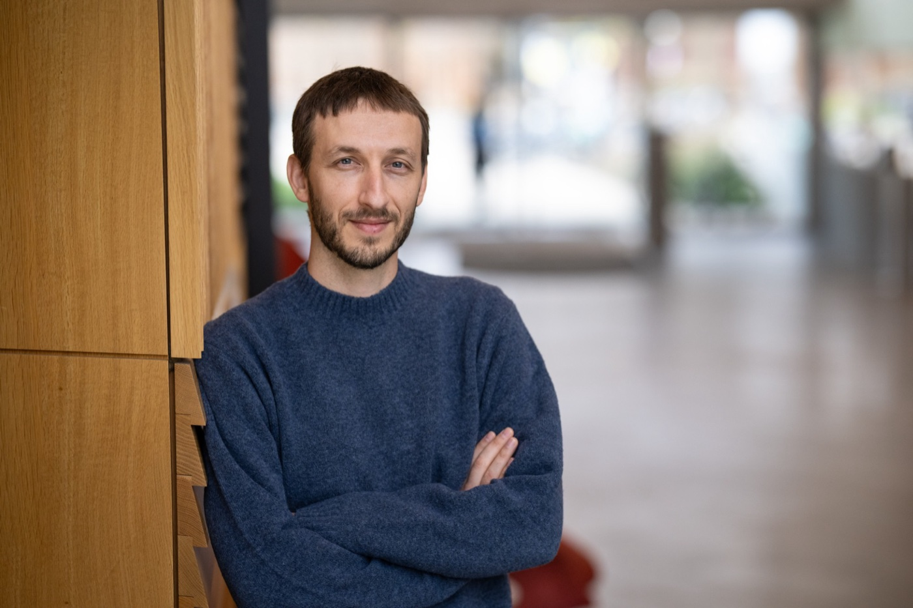

Hi, I’m Nitzan – a postdoctoral researcher at Yale and Princeton, working with Professors [Ken Norman](https://compmem.princeton.edu/) and [Nick Turk-Browne](https://ntblab.yale.edu/). Before that, I completed my Ph.D. at Tel Aviv University with Professor [Talma Hendler](https://en-social-sciences.tau.ac.il/profile/thendler). Prior to this, I attended the [Adi Lautman interdisciplinary program for outstanding students](https://excellent.tau.ac.il/english), studying Psychology, Biology and Philosophy.

My research explores the mechanisms of neurocognitive plasticity: how the human brain builds lasting, structured knowledge, how our internal models use this knowledge efficiently, and how we stay flexible enough to revise it in face of adversity. To answer these questions, I use behavioral methods, neuroimaging, machine learning techniques and closed-loop neurofeedback.
